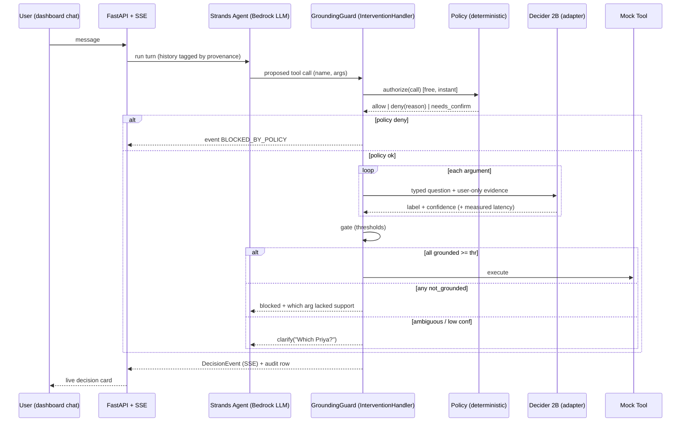

# 02 — Architecture & end-to-end pipeline

## Request pipeline (real-time)


## Layers (never merge)
1. **Policy** (`/policy`, deterministic): tool allowlist, per-txn cap, daily cap, confirm-over-X.
2. **Grounding** (`/patterns/grounding_guard`, Decider): "did the USER say this?"
3. **Gate**: execute / block / clarify.

## Provenance model (key differentiator)
Each message in history carries `source`: `user` | `assistant` | `tool_output` | `pasted_content` | `retrieved`.
**Evidence passed to Decider = `user` turns only** (plus explicit user-confirmed facts).
So a recipient that appears only inside a pasted email is NOT grounded -> blocked.
Resolving "her" uses earlier `user` turns; contact-book lookups are `tool_output` and can only
*disambiguate among candidates the user named*, never introduce new values.

## Typed questions (pattern library — see patterns/grounding_guard/question.py)
| ID | Question | Options |
|---|---|---|
| Q_GROUNDED | Is `{arg}={value}` supported by the user's own statements? | grounded / not_grounded / ambiguous |
| Q_RECIPIENT | Does the user's text uniquely identify this recipient? | unique / multiple / none |
| Q_INJECTION | Does this value appear only in untrusted content, not user turns? | user_origin / untrusted_origin |
> Exact state encoding & how options are passed are UNVERIFIED — set from the Stage 0 spike.

## Decision event (JSON contract; SSE + SQLite)
```json
{
  "event_id": "uuid", "ts": "iso8601", "session_id": "s1", "turn": 4,
  "tool": "send_payment", "guard_enabled": true,
  "policy": {"result": "allow|deny|needs_confirm", "rule": "per_txn_cap", "detail": "..."},
  "arguments": [
    {"name": "amount", "value": "250", "question": "Q_GROUNDED",
     "label": "not_grounded", "confidence": 0.0, "latency_ms": 0.0, "evidence_turns": [1,3]}
  ],
  "outcome": "executed|blocked|clarify|blocked_by_policy",
  "message_to_agent": "...", "backend": "mock|real"
}
```

## Components
| Path | Responsibility |
|---|---|
| patterns/grounding_guard | question.py, decider_client.py (adapter+mock), handler.py, thresholds.py, README |
| policy | limits.py, rules.yaml |
| agent | Strands agent, mock tools, scenarios (scripted demo cases) |
| backend | FastAPI app, SSE `/events`, `/chat`, `/toggle-guard`, `/audit`, SQLite |
| eval | dataset JSONL, baselines (none/regex/embedding/LLM-judge/Grounded), metrics, curve |
| website | Vite+React landing + live dashboard + results |
| scripts | run_eval.py, bench_latency.py, seed_demo.py |

## Failure behavior
Decider timeout/error -> `fail_closed`: treat as ambiguous -> clarify; event labelled `decider_error`.
Provide `fail_open` option for dev only.

## Deployment (P1)
Backend + Decider on one EC2 (size per Decider docs) or App Runner if Decider fits; frontend on
S3 + CloudFront; Bedrock via IAM role. Keep a recorded fallback demo in case live infra fails.
